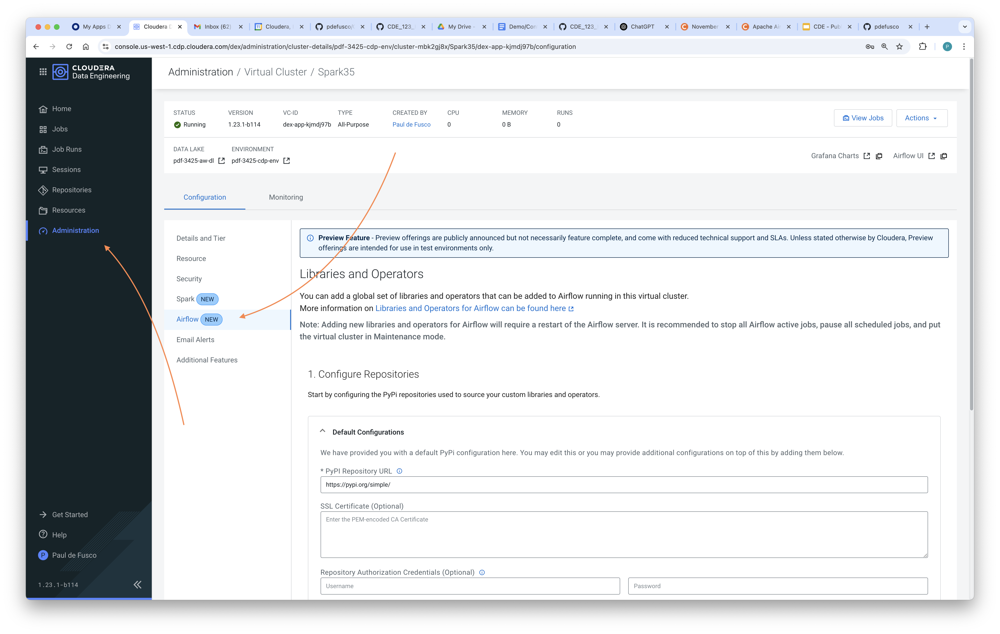
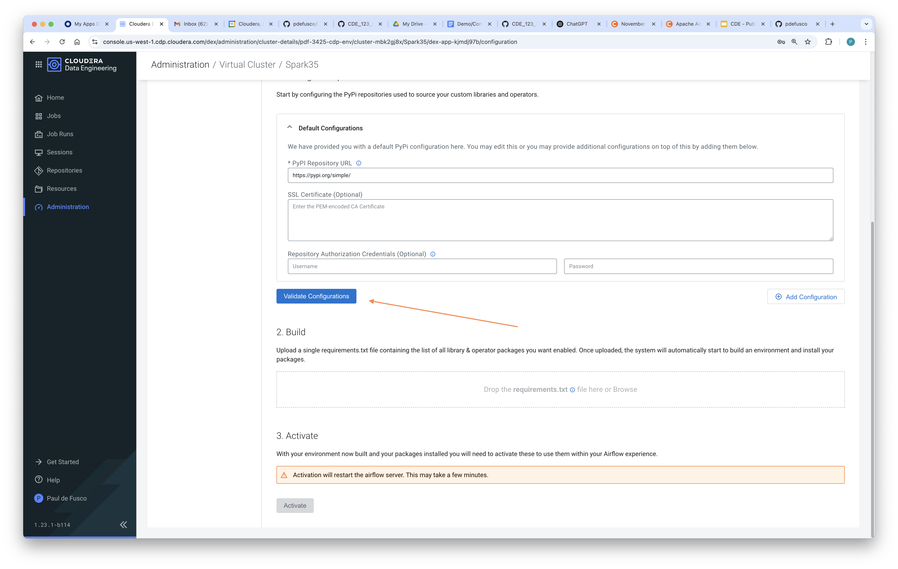
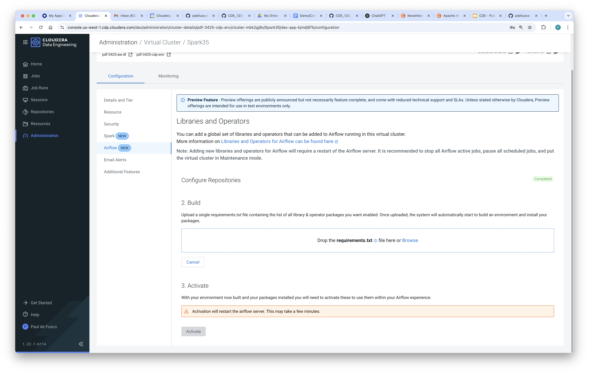
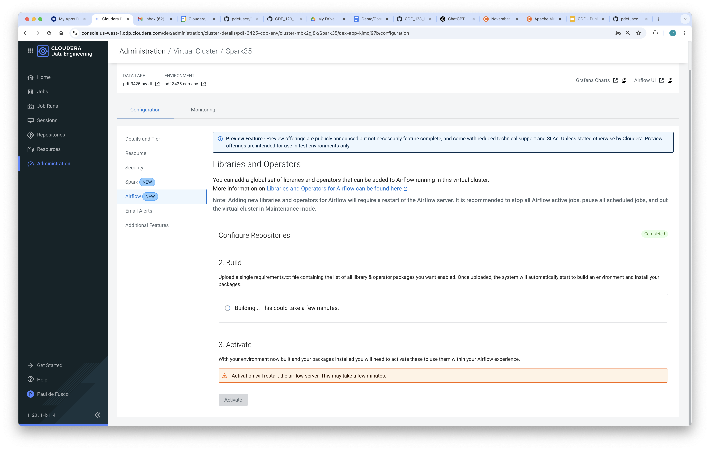
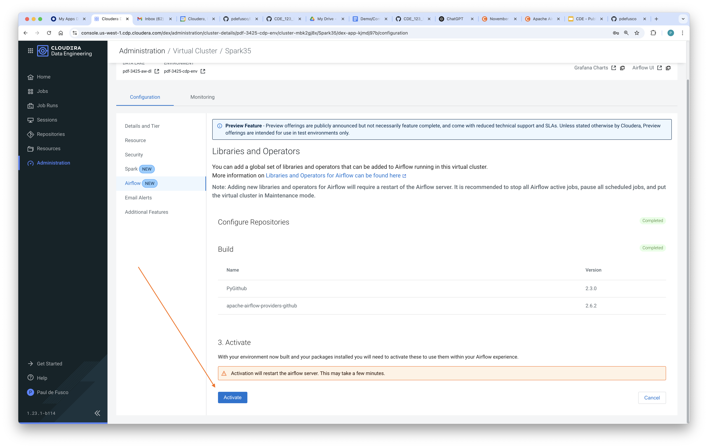
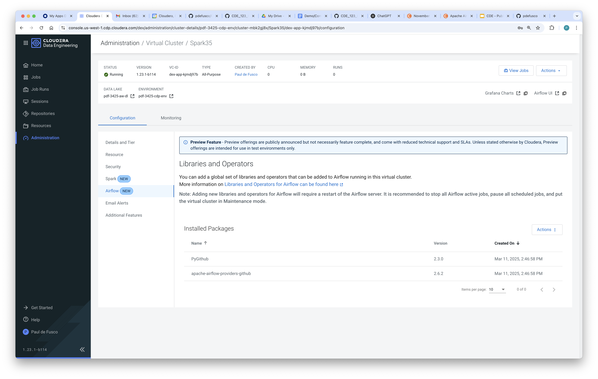
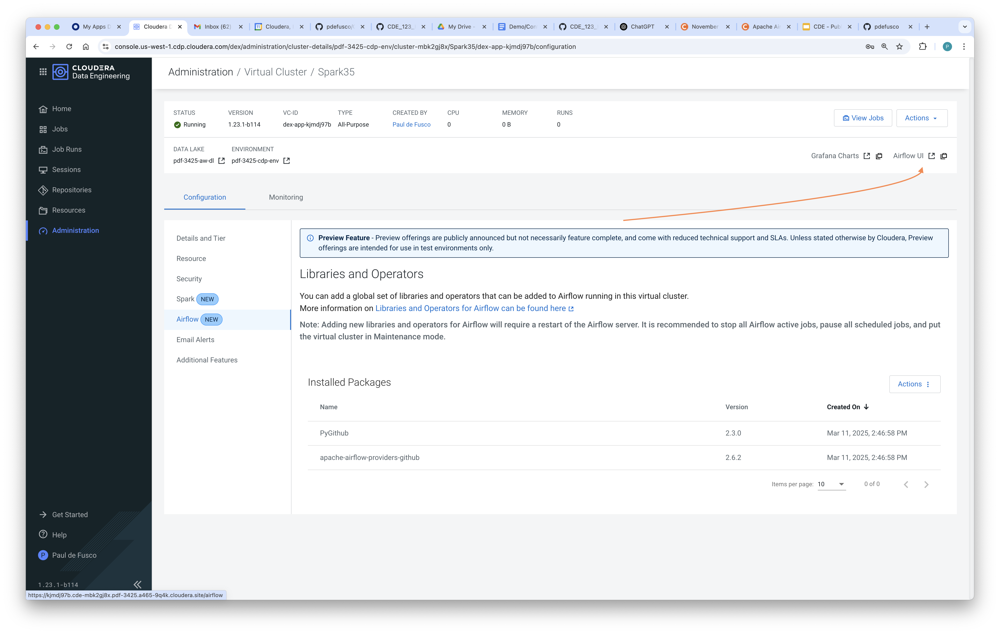
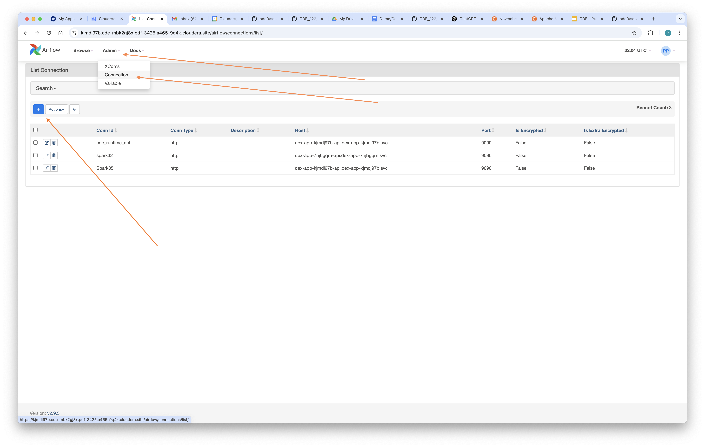
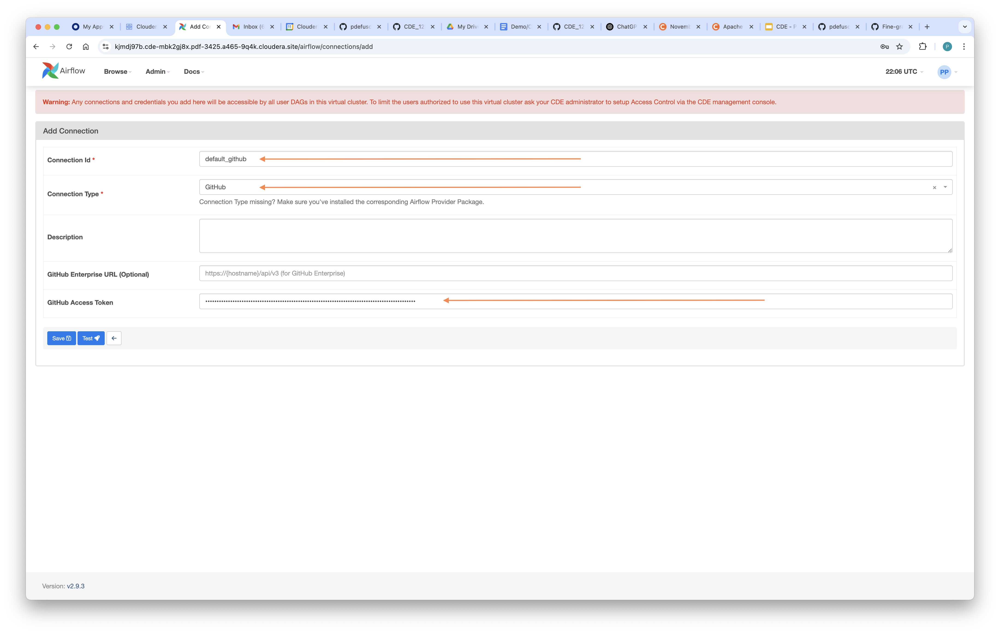
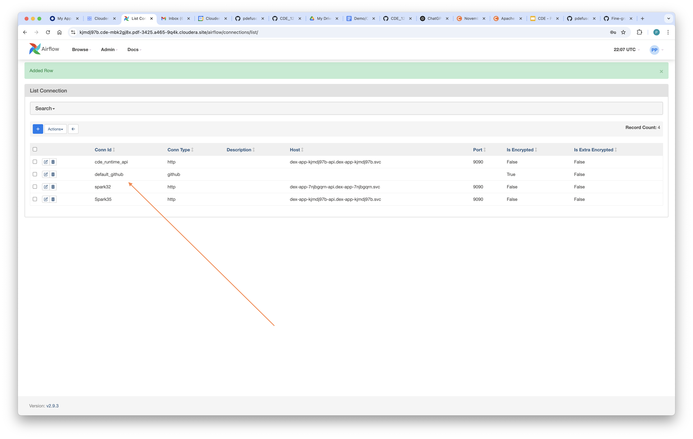

# CDE HOL Setup

## Objective

This document provides instructions for setting up HOL dependencies. The HOL lead must complete these steps as a requirement prior to the HOL event date.


## Table of Contents

* [Requirements](https://github.com/pdefusco/CDE_126_HOL/tree/main/setup#requirements)
* [Deployment Instructions](https://github.com/pdefusco/CDE_126_HOL/tree/main/setup#deployment-instructions)
* [Teardown Instructions](https://github.com/pdefusco/CDE_126_HOL/tree/main/setup#teardown-instructions)
* [Python Utils](https://github.com/pdefusco/CDE_126_HOL/tree/main/setup#python-utils)
* [Summary](https://github.com/pdefusco/CDE_126_HOL/tree/main/setup#summary)


## Requirements

To deploy the demo / HOL via this automation you need:

* A CDP tenant in Public or Private cloud.
* A CDP Workload User with Ranger policies and IDBroker Mappings configured accordingly. In particular, you must configure the Ranger Hadoop SQL and Raz (S3 or ADLS) policies accordingly.
* A CDE Service on version 1.26 (Spark 3.5.4, Python 3.11, Iceberg 1.5.2).
* At least two All-Purpose CDE Spark 3.5 Virtual Clusters for the labs. One will serve as DEV. One will serve as PRD. If you are hosting an HOL with many participants, organizing groups of 10 participants in multiple Dev & Prd VC pairs is highly recommended.
* A working local installation of the CDE CLI.
* A GitHub account. Keep your GitHub token handy.


## Deployment Instructions

There are four setup steps. All four can be done in parallel.

1. Create data using the Spark 3.5 Virtual Cluster. Using the DEV VC is recommended.
2. Create shared participant resources (files and Python resources) in all the Spark 3.5 VC's used throughout the labs.
3. Airflow configurations.
4. Participant IDE environment (local Docker, or EC2 with or without Docker).

In order to complete these requirements, clone this repository in your local machine and follow the steps below.

#### 1. Run new_deploy_hol.sh in the Spark 3.5 Virtual Cluster.

This step must only be run once.

Before proceeding, make sure to update your ~/.cde/config.yaml with your Spark 3.5 Virtual Cluster's CDE Jobs API URL.

Deployment script command template. Notice the demo argument. Currently, "bank" and "manufacturing" are the two supported demos.

```
% ./setup/new_deploy_hol.sh <cdp-workload-user> <max-hol-participants> <storage-location> <demo>
```

You must always create data in the data directory. For example:

```
#AWS
% ./setup/new_deploy_hol.sh pauldefusco 10 s3a://pdf101126-buk-b8415038/data/cde-126-hol bank
```

```
#Azure
% ./setup/new_deploy_hol.sh pauldefusco 7 abfs://logs@go01demoazure.dfs.core.windows.net/data/cde-126-hol manufacturing
```

#### 2. Run deploy_hol_resources.sh in all the Spark 3.5 Virtual Clusters used by Participants.

You must repeat these steps for each Spark 3.5 VC in which HOL participants will work through the labs.

Before proceeding, make sure to update your ~/.cde/config.yaml with your Spark 3.5 Virtual Cluster's CDE Jobs API URL.

Deployment script command template:

```
% ./setup/deploy_hol_resources.sh <cdp-workload-user> <vcluster-endpoint> <demo>
```

For example:

```
#AWS
% ./setup/deploy_hol_resources.sh pauldefusco https://m4748n78.cde-wf5mpw7s.pdf10112.a465-9q4k.cloudera.site/dex/api/v1 bank
```

```
#Azure
% ./setup/deploy_hol_resources.sh pauldefusco https://k5hzst9x.cde-jhnkv684.pdf-jul.a465-9q4k.cloudera.site/dex/api/v1 manufacturing
```

#### 3. Airflow Configurations

In this step you will install the GitHub operator in the Airflow Python Environment and create the GitHub Airflow connection in all the Spark 3.5 VC's used throughout the labs. You must repeat these steps for each Spark 3.5 VC in which HOL participants will work through the labs.

First, open the Airflow tab of the Virtual Cluster Details page and install the GitHub operator as shown below.













Then, create the GitHub Connection. Make sure to name the Conection ID with "default_github" and then paste the GitHub token in the respective field.









#### 4. Participant IDE Environment

Participants run the CDE CLI and Spark Connect from JupyterLab. Pick one of the following options:

1. **Local Docker (default):** participants run `docker run -p 8888:8888 pauldefusco/cde_126_hol` on their own machine. No admin action is needed.
2. **EC2 with Docker:** launch one EC2 instance per participant with `setup/aws-bootstrap.sh` as user data. It runs the same container on port 80.
3. **EC2 without Docker:** launch one EC2 instance per participant with `setup/aws-bootstrap-native.sh` as user data. It installs Python 3.11, JupyterLab, the CDE CLI and the CDE 1.26 Spark Connect packages directly on the instance and serves JupyterLab on port 80 as a systemd service.

For options 2 and 3:

* AMI: Amazon Linux 2023 (x86_64). Instance type: t3.large or larger.
* Security group: allow inbound TCP 80 only from participant IP ranges. JupyterLab is token-less by default. To require a password, set `JUPYTER_PASSWORD` at the top of `setup/aws-bootstrap-native.sh` before launching.
* Pass the script as user data, e.g. `aws ec2 run-instances --image-id <al2023-ami> --instance-type t3.large --security-group-ids <sg> --subnet-id <subnet> --user-data file://setup/aws-bootstrap-native.sh --count <participants>`.
* Bootstrapping takes a few minutes. Progress is logged to `/var/log/user-data.log` on the instance. Check the service with `sudo systemctl status jupyterlab`.

##### Rebuilding the Docker Image

The image bakes in the CDE 1.26 CLI and Spark Connect tarballs. The large binaries are not committed to git; they are published as assets of the `v1.26-assets` GitHub Release. To rebuild and push the image:

1. Download the `cdeconnect` tarball from the Connect tab of a Spark Connect session in your 1.26 Virtual Cluster and place it in `spark-connect/`.
2. Run `./docker/build.sh`. It downloads the CLI and pyspark tarball from the release if missing, then builds for linux/amd64 and pushes `pauldefusco/cde_126_hol:1.26.1` and `:latest`. Use `./docker/build.sh --no-push` to build locally only.


## Teardown Instructions

When you are done run this script to tear down the data in the Catalog but not in S3. That step will be handles by the GOES teardown scripts.

```
% ./teardown.sh cdpworkloaduser
```

## Python Utils

#### Destroy All Jobs for an HOL Participant

You can delete all jobs created by a particular hol user by running the "setup/destroy_jobs.py" script from your local machine.

This is useful when a particular hol participant needs to start the labs from scratch after having completed only some of the labs.

Before running, edit the following parameters:

* Lines 48, 49: add Jobs API URL's of Virtual Clusters where you want to remove the user's jobs.
* Line 50: add hol_username e.g. "user001"
* Line 52: workload username for authenticating against the CDE VC.
* Line 53: workload password for authenticating against the CDE VC.

## Summary

You can deploy an end to end CDE Demo with the provided automation. The demo executes a small ETL pipeline including Iceberg, Spark and Airflow.
